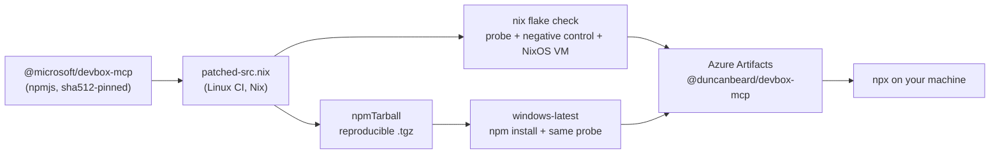

# devbox-mcp, with delete compiled out

The [Microsoft Dev Box MCP server](https://github.com/microsoft/devbox-mcp-server)
(`@microsoft/devbox-mcp`), patched with a Nix overlay so that **an agent cannot delete
anything through it**. The delete code paths are removed from the binary, not hidden by
a prompt or a config flag.

This applies the pattern from Geoffrey Huntley's
[*you can literally just fix everything with a Nix overlay*](https://ghuntley.com/nix)
([ghuntley/nix-demo](https://github.com/ghuntley/nix-demo) removes `git push --force` the
same way) to an MCP server.

## Why not just configure it?

| Approach | Problem |
|---|---|
| Prompt: "never delete a Dev Box" | The model can ignore it. |
| Client-side tool approval | It's a habit. One "Allow always" click undoes it. |
| `--disallowed-tools devbox_resource` (upstream flag) | Applies to the whole tool, so you also lose list, get and create. It's also opt-in config, and an agent that can edit `mcp.json` can remove it. |
| Azure RBAC without delete permission | The right server-side control, if you own the role assignments. It doesn't help on machines where your identity *can* delete. |
| **Patch the server** | The tool schema has no `delete`, and the process can't send one. Nothing to bypass. |

Use RBAC too if you can. This patch is the client-side half.

## What upstream exposes (0.0.3-alpha.4)

| Path | Upstream | Patched |
|---|---|---|
| `devbox_resource` `operation: "delete"` → `DELETE /projects/{p}/users/{u}/devboxes/{name}` | yes | **gone** |
| `workplanner_delete_task` → `POST /api/taskprocessor/delete-task` | yes (corp + `DEVBOX_MCP_WORKPLANNER_ENABLED`) | **gone** |
| SDK `environments.deleteEnvironment` (no tool uses it yet) | reachable code | **refused** |

Everything else is unchanged: `devbox_resource` read/create, `devbox_action`
start/stop/restart/repair, schedules, customizations, pools and projects.

## How: three layers in one derivation

Upstream ships a single minified bundle (`dist/devbox-mcp-server.mjs`, 880 KB on one line),
so a unified `.patch` doesn't work well. Each patch site in
[`third_party/devbox-mcp/default.nix`](third_party/devbox-mcp/default.nix) is a
`substituteInPlace --replace-fail`. **If upstream changes the code around a patch site,
the build fails.** It never silently ships an unpatched server. After patching, the build
also checks that the removed shapes are gone.

| Layer | Where | Effect |
|---|---|---|
| **001 tool surface** | zod schema, operation dispatch, scope validation, `deleteDevBox` handler; tool registries + base-class `register()` (the one place every tool calls `server.tool()`) | `devbox_resource.operation` enum is `["read","create"]`, so a `delete` call fails MCP validation (`-32602`). No tool matching `/delete/i` can register. |
| **002 Azure SDK** | `ServiceClient.sendOperationRequest`, `NodeHttpClient.sendRequest` | Any operation spec with `httpMethod: "DELETE"` throws before it is sent. This covers future SDK delete operations too. |
| **003 process guard** | [`delete-guard.mjs`](third_party/devbox-mcp/delete-guard.mjs), injected as the bundle's **first** `import` | Wraps `fetch`, `http.request/get` and `https.request/get`. No `DELETE` request and no request to a `/delete…` path can leave the process. |

Layer 3 does the job of nix-demo's `set_ref_status_for_push` patch: it is a single choke
point that catches whatever the more specific patches miss.

```
third_party/devbox-mcp/
  upstream.json              pinned upstream version + sha512 + npmDepsHash (bot-updated)
  package-json.jq            package.json edits, shared by Nix and the bump script
  patched-src.nix            THE patch: substitutions + guard → platform-independent source tree
  delete-guard.mjs           layer 003
  default.nix                Linux build (node_modules) for nix run / VM / OCI
  package-lock.json
nix/overlay.nix              pkgs.devbox-mcp{,-src,-npm}   ← single source of truth
nix/npm-tarball.nix          patched source re-packed as @duncanbeard/devbox-mcp .tgz
nix/publish.json             published package name + patch revision
nix/tests/probe.mjs          MCP-over-stdio + guard behavioural test (Linux and Windows)
nix/tests/no-delete.nix      sandboxed check + negative control against stock upstream
nix/tests/no-delete-vm.nix   NixOS VM test (runNixOSTest)
nix/docker.nix               OCI image of the patched server
scripts/bump-upstream.sh     re-pin a new upstream release
.github/workflows/ci.yml     nix check → Windows smoke test → publish to Azure Artifacts
.github/workflows/bump-upstream.yml   daily upstream check → PR
```

## Tests

```console
nix build .#checks.x86_64-linux.no-delete -L      # seconds, runs in the build sandbox
nix build .#npmTarball && nix build .#npmTarball --rebuild   # publishable .tgz, reproducible
nix build .#checks.x86_64-linux.no-delete-vm -L   # boots a NixOS VM (needs kvm + nixos-test features)
nix flake check
```

`probe.mjs` starts the real server binary and talks MCP to it:

- `tools/list` contains no tool matching `/delete/i`, and `devbox_resource.operation.enum`
  is exactly `["read","create"]`.
- Calling `devbox_resource` with `operation: "delete"` is refused, and so is calling
  `workplanner_delete_task`.
- It loads the guard and sends nine delete attempts (`fetch`, `Request`, `http`, `https`,
  `http.get`, lowercase `delete`, and `POST /delete-task`) at a local HTTP server. All
  nine are refused in-process, and the server records **zero** of them. GET and POST
  still get through.
- **Negative control:** the same probe runs against `pkgs.devbox-mcp-unpatched` and must
  *fail*. This shows the probe actually detects an exposed delete.

## Use it on Windows (published package)

Nix runs only in CI. Windows installs the result like any other npm package:



1. Point the scope at the feed in `%USERPROFILE%\.npmrc` and authenticate as you do for
   other Azure Artifacts feeds (`vsts-npm-auth` / artifacts-npm-credprovider):

   ```ini
   @duncanbeard:registry=https://pkgs.dev.azure.com/<org>/<project>/_packaging/<feed>/npm/registry/
   ```

2. Replace the upstream entry in `.vscode/mcp.json` (or any MCP client config):

   ```jsonc
   {
     "servers": {
       "DevBox": { "command": "npx", "args": ["-y", "@duncanbeard/devbox-mcp@latest"] }
     }
   }
   ```

Auth is unchanged from upstream: WAM, Azure CLI and the rest of `DefaultAzureCredential`.

Versions are `<upstream>.nodelete.<revision>`, for example `0.0.3-alpha.4.nodelete.1`. They
sort after the upstream version and before the next upstream release.

### What the pipeline guarantees

- **One patcher.** Only `patched-src.nix` modifies upstream. CI, the VM, the Windows test
  and the published package all use those same bytes. The sha512 is checked at every hop,
  and a [build provenance attestation](https://docs.github.com/actions/security-for-github-actions/using-artifact-attestations)
  is attached to each publish when the repo is public. Private repos need GitHub
  Enterprise Cloud for attestations, so the step is skipped there.
- **Reproducible.** `nix build .#npmTarball --rebuild` must produce identical bytes.
  Publishing therefore can't silently overwrite anything: if the feed already has the
  version with the same bytes, CI does nothing. If it has the version with *different*
  bytes, CI fails and asks you to bump `revision` in `nix/publish.json`.
- **Tested where it runs.** The Windows job installs the exact tarball with real native
  deps (keytar, WAM broker) and runs the same MCP probe. On a corp identity the WorkPlanner
  tools register, which makes the `workplanner_delete_task` check meaningful (stock upstream
  lists it, the patched build doesn't).
- **Upstream drift fails loudly.** `bump-upstream.yml` re-pins new releases daily and opens a
  PR. A moved patch site is a `--replace-fail` build error and turns the PR red. Nothing
  publishes until the PR merges and `main` is green.

### One-time setup

1. ~~Push this repo to GitHub.~~ Done: <https://github.com/DuncanBeard/devbox-mcp>. Until step 2 is set, the publish job is skipped.
2. **Variable** `AZURE_ARTIFACTS_NPM_REGISTRY` =
   `https://pkgs.dev.azure.com/<org>/<project>/_packaging/<feed>/npm/registry/`
   (omit `<project>/` for an org-scoped feed).
3. **Feed auth** (pick one):
   - *OIDC, preferred:* an Entra app with a federated credential for
     `repo:DuncanBeard/devbox-mcp:environment:azure-artifacts`. Add its service principal to the
     Azure DevOps org with **Feed Publisher (Contributor)** on the feed. Set variables
     `AZURE_CLIENT_ID` and `AZURE_TENANT_ID`.
   - *PAT:* secret `AZURE_ARTIFACTS_PAT` with *Packaging (read & write)*.
4. **Environment** `azure-artifacts` (Settings → Environments). Add required reviewers if
   you want a human gate on publishing.
5. **Bump PRs:** Settings → Actions → General → *Allow GitHub Actions to create and approve
   pull requests*. Optionally add secret `BOT_TOKEN` (a GitHub App or fine-grained PAT) so
   CI runs on the bot's PRs. PRs opened with `GITHUB_TOKEN` don't trigger workflows.
6. **Package name:** `nix/publish.json`. Keep it scoped to something you own. If the feed
   has npmjs as an upstream source, an unscoped name is open to dependency confusion.

> Corp policy note: Microsoft Azure DevOps orgs often restrict which identities and
> tenants can connect. If OIDC from a personal GitHub account is blocked, host the repo in
> a corp-linked GitHub org (or run the same steps in Azure Pipelines). The Nix side
> doesn't change.

## Use it with Nix (Linux / WSL)

```jsonc
{ "servers": { "DevBox": { "command": "nix", "args": ["run", "github:DuncanBeard/devbox-mcp"] } } }
```

From another flake, add this repo as an input and apply `overlays.default`. On Linux,
authentication goes through `az login`, because WAM is Windows-only.

## Limits

- This removes the **MCP server's** delete capabilities. It does not limit what your Azure
  identity can do through other tools. If the agent also has `az`, a shell or a browser,
  restrict those separately (or use RBAC).
- `task_resource` runs customization tasks *on* a Dev Box. Those commands run on the
  remote machine, not in this process, so this patch doesn't filter them.
- The guard covers `fetch`, `http` and `https`. The bundle doesn't use `http2`, and
  hand-writing raw HTTP over `net`/`tls` sockets isn't covered. (Layer 002 still blocks
  the SDK paths.)

## Bumping upstream

This happens automatically (see above). To do it by hand:

```console
nix develop .#bump -c ./scripts/bump-upstream.sh [version]   # default: latest dist-tag
nix flake check -L
```

If a `--replace-fail` breaks, find the new shape in `dist/devbox-mcp-server.mjs` and
update that one substitution in `third_party/devbox-mcp/patched-src.nix`. Also look
through the upstream release for **new** destructive tools whose names don't contain
"delete". The network guard blocks any HTTP `DELETE` regardless of the tool's name, but a
destructive `POST` to an endpoint without "delete" in its path would get through.

If you change the patch without an upstream bump, increment `revision` in
`nix/publish.json`. CI refuses to publish different bytes under an existing version.
